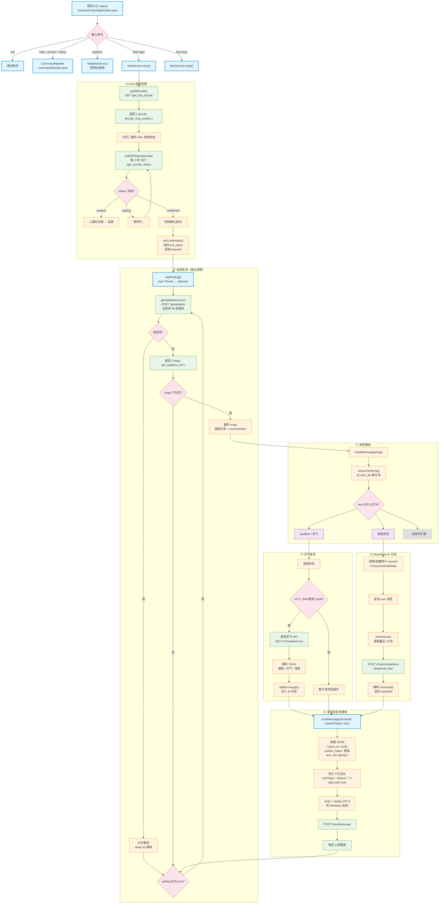

# Claw助手 流程图



## 项目文件结构

### 入口层
```
YoukedaProjectApplication.java     ─  main() 入口 + 控制台循环
```

### 协议层（iLink DTO，共 7 个文件）
```
protocol/
 ├── QRCodeResponse.java            ─  get_bot_qrcode 响应
 ├── LoginResult.java               ─  get_qrcode_status 响应（含 bot_token）
 ├── GetUpdatesResponse.java        ─  getupdates 响应（含消息列表 + 游标）
 ├── WeixinMessage.java             ─  单条微信消息结构
 ├── MessageItem.java               ─  消息条目（可嵌套文本/图片等）
 ├── TextItem.java                  ─  文本内容
 └── SendMessageRequest.java        ─  sendmessage 请求体
```

### 客户端层
```
client/
 └── IlinkProtocolClient.java       ─  iLink HTTP 客户端（getQRCode / pollQRStatus /
                                       getUpdates / sendMessage + 认证头生成）
```

### 服务编排层
```
service/
 ├── IlinkService.java              ─  登录流程 + 消息轮询线程 + 消息路由分发
 └── WeatherService.java            ─  和风天气 API 查询（预置 10 城市）
```

### AI 层（DeepSeek DTO，共 5 个文件）
```
ai/
 ├── AIService.java                 ─  DeepSeek API 对话（每用户独立 session）
 ├── ChatRequest.java               ─  请求体
 ├── ChatResponse.java              ─  响应体
 ├── ChatMessage.java               ─  消息体（role + content）
 └── ChatChoice.java                ─  选择结果
```

### 配置层
```
config/
 └── ApiConfig.java                 ─  读取 application.properties（weather + ai）
```

### 命令层
```
command/
 └── CommandHandler.java            ─  控制台命令分发（help/version/status/ilink）
```
