# Claw助手 流程图

WeChat Bot · iLink 协议 · 和风天气 · DeepSeek AI · 通义万相 · 通义千问 VL · Apache Tika · CosyVoice TTS

---

## 0. 程序入口 — 控制台循环

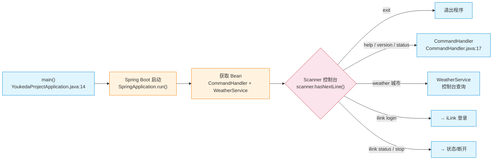

Spring Boot 启动后进入 `main()`，使用 `Scanner` 监听控制台输入。
支持命令：`help` / `version` / `status` / `weather <城市>` / `ilink login/status/stop` / `exit`。

---

## 1. iLink 登录流程

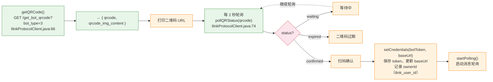

请求微信 iLink 服务器获取二维码 → 返回 `qrcode_id` 和二维码 URL → 打印到控制台 → 每 2 秒轮询状态 → 用户扫码确认后返回 `bot_token`（身份凭证）和 `baseUrl`。登录成功后记录 `ownerId`（`ilink_user_id`），用于后续欢迎消息触发。

★ `LoginResult` 包含 `ilink_user_id`（主人微信ID）、`ilink_bot_id`（机器人ID）、`bot_token`、`baseUrl`。

---

## 2. 消息轮询（独立线程）

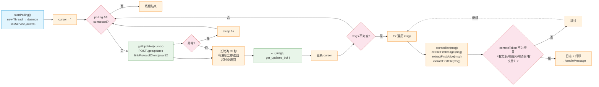

长轮询：服务器挂起最多 35 秒，有消息立即返回。每次返回 `get_updates_buf`（游标），下次请求时带回，确保不重复消费。过滤条件：必须有 `contextToken`，且至少包含文本、图片、语音或文件之一。

---

## 3. 消息路由 — handleMessage

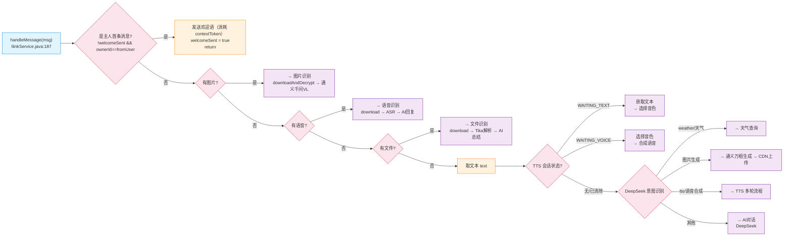

路由流程（按优先级）：
1. **首条消息检测**：若为登录记录的主人首次发消息，仅回复欢迎语（消耗该消息），不处理内容
2. **图片消息**：CDN 下载 → AES 解密 → 通义千问 VL 识别
3. **语音消息**：CDN 下载 → ASR 转文字 → AI 回复
4. **文件消息**：CDN 下载 → AES 解密 → Apache Tika 提取文本 → AI 总结
5. **文本消息**：
   - TTS 多轮会话中 → 根据状态获取文本/选择音色/合成语音
   - `weather` / `天气` 开头 → 和风天气查询
   - `图片生成` 开头 → 通义万相生图 → CDN 上传 → 图片消息
   - `tts` / `朗读` 等 → 进入 TTS 多轮流程
   - 其他 → DeepSeek AI 对话

---

## 4. 首条消息欢迎机制

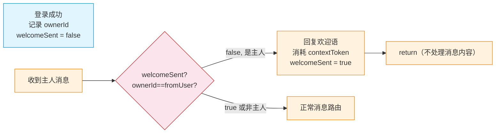

因 iLink 协议不支持 Bot 主动推送消息，欢迎语通过「消耗主人第一条消息」的方式发送。
首次连接后，主人发的第一条消息会被用于回复欢迎语（消息内容被消耗不处理）。

---

## 5. 天气查询（和风天气）

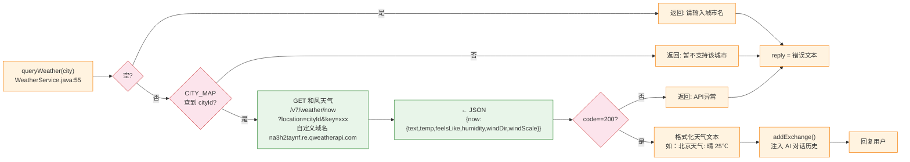

预置 10 城市 ID 映射表（北京/上海/广州/深圳/杭州/成都/武汉/南京/西安/重庆）。通过自定义域名 `na3h2taynf.re.qweatherapi.com` 请求和风天气 API，解析 JSON 后格式化为可读文本。结果注入 AI 对话历史，便于后续上下文追问。

---

## 6. AI 对话（DeepSeek）

```mermaid
flowchart LR
    AS["sessions.computeIfAbsent(userId)<br>ConcurrentHashMap<br>AIService.java:48"]:::process
    AE{"首次对话?"}:::decision
    AS --> AE
    AE --> |"是"| AN["创建 session<br>添加 system 消息"]:::process
    AE --> |"否"| AO["使用现有历史"]:::process
    AN --> AA
    AO --> AA
    AA["追加 user 消息到历史"]:::process
    AT["trimHistory()<br>保留最近 10 轮"]:::process
    AR["POST /chat/completions<br>model: deepseek-chat<br>api.deepseek.com<br>byte[] 编码防乱码"]:::api
    AX["← choices[0].message.content"]:::api
    AA --> AT --> AR --> AX
    AX --> AC{"有内容?"}:::decision
    AC --> |"否"| AER["返回: 无内容"]:::process
    AC --> |"是"| AAS["追加 assistant 回复到历史"]:::process
    AAS --> AOK["reply = AI 回复 → 回复用户"]:::process

    classDef process fill:#fff3e0,stroke:#f57c00;
    classDef decision fill:#fce4ec,stroke:#c62828;
    classDef api fill:#e8f5e9,stroke:#388e3c;
```

每个微信用户独立对话 session（`ConcurrentHashMap<String, List<ChatMessage>>`），结构：`[system, user, assistant, user, ...]`。最多保留 10 轮对话，超出截断。使用 `byte[]` 编解码防止 Windows 控制台乱码。

★ DeepSeek 同时负责意图识别（`detectIntent`），返回 JSON 路由到天气/图片生成/TTS/对话。

---

## 7. 图片识别（通义千问 VL）

```mermaid
flowchart LR
    IR["handleMessage → 有图片<br>IlinkService.java:202"]:::entry
    IR --> DL["downloadAndDecryptImage()<br>IlinkProtocolClient.java:138"]:::process
    DL --> URL{"media.full_url<br>或 encrypt_query_param?"}:::decision
    URL --> |"full_url"| D1["GET full_url<br>下载加密字节"]:::api
    URL --> |"encrypt_query_param"| D2["拼接 CDN_BASE + /download<br>?encrypted_query_param=..."]:::process
    D2 --> D1
    D1 --> AES{"有 aeskey?"}:::decision
    AES --> |"否"| RAW["返回原始密文"]:::process
    AES --> |"是"| K["deriveAesKey()<br>3种格式兼容解析"]:::process
    K --> DEC["AES-128-ECB 解密<br>去除 PKCS7 padding"]:::process
    DEC --> B64["Base64 编码 + 检测 MIME<br>→ data:image/jpeg;base64,..."]:::process
    B64 --> VL["通义千问 VL<br>POST dashscope 兼容模式<br>model: qwen-vl-plus<br>content: [{text},{image_url}]"]:::api
    VL --> RESP["← choices[0].content<br>图片描述文本"]:::api
    RESP --> SEND["回复用户"]:::process

    classDef process fill:#fff3e0,stroke:#f57c00;
    classDef decision fill:#fce4ec,stroke:#c62828;
    classDef api fill:#e8f5e9,stroke:#388e3c;
```

1. **CDN 下载**：从 `image_item.media.full_url` 或拼接 CDN URL 下载 AES 加密的图片字节
2. **AES 解密**：`deriveAesKey()` 兼容 3 种 key 格式（32字符 hex / base64(hex) / base64(raw 16字节)），AES-128-ECB 解密后去除 PKCS7 padding
3. **视觉识别**：图片 Base64 → `data:` URI → 通义千问 VL（`qwen-vl-plus`），复用 DashScope key

---

## 8. 图片生成（通义万相）→ CDN 上传 → 发送

```mermaid
flowchart LR
    IG["handleMessage → 图片生成 xxx<br>IlinkService.java:285"]:::entry
    IG --> GEN["generateImage(prompt)<br>ImageService.java:32"]:::process
    GEN --> API["通义万相<br>POST /multimodal-generation/generation<br>model: wan2.6-t2i<br>DashScope"]:::api
    API --> RESP["← output.choices[0].content[0].image<br>OSS 图片 URL"]:::api
    RESP --> OK{"URL 有效?"}:::decision
    OK --> |"否"| ERR["回复错误文本"]:::process
    OK --> |"是"| DL2["downloadImage(url)<br>从 OSS 下载图片字节"]:::process
    DL2 --> ENC["AES-128-ECB 加密<br>随机生成 16 字节 key"]:::process
    ENC --> MD5["计算 rawfilemd5<br>计算 padded filesize"]:::process
    MD5 --> UPL["getUploadUrl<br>POST /ilink/bot/getuploadurl<br>含 filekey/aeskey/rawsize/rawfilemd5"]:::api
    UPL --> UPL_R["← upload_full_url 或 upload_param"]:::api
    UPL_R --> CDN["POST 加密字节到 CDN URL"]:::process
    CDN --> CDN_R["← x-encrypted-param header"]:::api
    CDN_R --> SEND2["发送 image_item<br>encrypt_query_param + aes_key<br>→ sendMessage"]:::process
    SEND2 --> DONE["用户收到图片"]:::process

    classDef process fill:#fff3e0,stroke:#f57c00;
    classDef decision fill:#fce4ec,stroke:#c62828;
    classDef api fill:#e8f5e9,stroke:#388e3c;
```

1. **生图**：通义万相 `wan2.6-t2i`（同步模式 POST），返回 OSS 图片 URL
2. **加密**：随机 16 字节 AES key → AES-128-ECB 加密图片字节（PKCS5Padding）
3. **CDN 上传**：请求上传 URL → POST 加密字节 → 获取 `x-encrypted-param`
4. **发送**：构建 `image_item.cdnImage(CDNMedia, midSize)` → `sendMessage`

★ `getUploadUrl` 请求包含：`filekey`（32 hex）、`media_type:1`、`to_user_id`、`rawsize`、`rawfilemd5`、`filesize`（填充后）、`aeskey`（hex）、`no_need_thumb:true`。

---

## 9. 文件识别（Apache Tika）→ CDN 上传 → 发送

```mermaid
flowchart LR
    FR["handleMessage → 有文件<br>IlinkService.java:248"]:::entry
    FR --> FV["fileItem = msg.fileItem()<br>获取文件名 + 文件大小"]:::process
    FV --> SZ{"fileSize > 20MB?"}:::decision
    SZ --> |"是"| SZR["回复: 文件太大"]:::process
    SZ --> |"否"| DL["downloadAndDecryptFile(fileItem)<br>IlinkProtocolClient.java:191<br>CDN下载 + AES-ECB解密"]:::process
    DL --> EXT["fileService.extractText(fileBytes, fileName)<br>FileService.java:41<br>Apache Tika 自动检测格式"]:::process
    EXT --> PT{"纯文本文件?<br>txt/csv/json/xml/md等"}:::decision
    PT --> |"是"| FAST["直接 UTF-8 读取<br>跳过 Tika 开销"]:::process
    PT --> |"否"| TIKA["Tika.parseToString()<br>解析 docx/pdf/xlsx/pptx等"]:::process
    FAST --> TRUNC["截断到 8000 字符<br>避免 AI token 超限"]:::process
    TIKA --> TRUNC
    TRUNC --> AI["aiService.generateWithContext()<br>文件名 + 提取文本<br>→ DeepSeek 总结"]:::external
    AI --> SEND["sendMessage(text)<br>回复用户"]:::process

    classDef entry fill:#e1f5fe,stroke:#0288d1;
    classDef process fill:#fff3e0,stroke:#f57c00;
    classDef decision fill:#fce4ec,stroke:#c62828;
    classDef api fill:#e8f5e9,stroke:#388e3c;
    classDef external fill:#f3e5f5,stroke:#7b1fa2;
```

**文件识别流程：**

1. **下载解密**：从 `file_item.media` 获取 CDN URL → 下载 AES 加密字节 → `deriveAesKey()` + AES-ECB 解密
2. **文本提取**（`FileService`）：
   - **纯文本快速路径**：`txt/csv/json/xml/md/java/py/js` 等扩展名直接 UTF-8 读取，跳过 Tika
   - **Tika 解析**：`docx/xlsx/pptx/pdf/html` 等格式，Tika 通过文件头 magic bytes 自动检测格式，无需依赖扩展名
   - 提取结果截断到 8000 字符，避免超出 DeepSeek token 限制
3. **AI 总结**：将文件名 + 提取文本发送给 DeepSeek，生成自然语言总结
4. **回复用户**：发送文本消息

★ `downloadAndDecryptFile()` 与 `downloadAndDecryptImage()` 流程相同（CDN下载 + AES-ECB 解密），仅入参类型不同（`FileItem` vs `MessageItem`）。
★ 文件大小限制 20MB（`FileService.MAX_FILE_SIZE`），超过直接拒绝。
★ `tika-core:2.9.4` + `tika-parsers-standard-package:2.9.4` 提供完整解析能力。

---

## 10. 语音合成 TTS（CosyVoice-v3-flash）

```mermaid
flowchart LR
    TTS0["DeepSeek 意图识别<br>intent = 'tts'"]:::entry
    TTS0 --> CK{"有朗读内容?"}:::decision
    CK --> |"否"| ASK["追问: 请告诉我你想朗读什么<br>state = WAITING_TEXT"]:::process
    ASK --> U1["用户回复文本"]:::process
    U1 --> S1["ttsSession.text = text<br>state = WAITING_VOICE"]:::process
    S1 --> VOICE["回复: 请选择音色<br>列出 6 种音色"]:::process
    VOICE --> U2["用户选择音色"]:::process
    U2 --> S2["resolveVoice(voiceName)<br>→ voiceId"]:::process
    CK --> |"是"| VOICE2["回复: 请选择音色"]:::process
    VOICE2 --> U2
    S2 --> SYN["ttsService.synthesizeMp3(text, voiceId)<br>调用 CosyVoice TTS API<br>→ MP3 音频字节"]:::api
    SYN --> UPLOAD["client.uploadAndSendFile()<br>media_type=3 (FILE)<br>→ CDN上传 → file_item(type=4)"]:::process
    UPLOAD --> DONE["用户收到语音文件"]:::process

    classDef entry fill:#e1f5fe,stroke:#0288d1;
    classDef process fill:#fff3e0,stroke:#f57c00;
    classDef decision fill:#fce4ec,stroke:#c62828;
    classDef api fill:#e8f5e9,stroke:#388e3c;
```

**TTS 多轮流程：**

1. **意图检测**：DeepSeek 识别 `tts`/`朗读`/`语音合成` 等意图，返回 `intent=tts`
2. **获取文本**（`WAITING_TEXT`）：若未指定朗读内容，追问用户；用户回复后存入 `ttsSession.text`
3. **选择音色**（`WAITING_VOICE`）：列出 6 种 CosyVoice 音色供选择
4. **合成语音**：调用 CosyVoice API（`cosyvoice-v3-flash`）→ 返回 MP3 音频
5. **CDN 上传发送**：`uploadAndSendFile()` 使用 `media_type=3`（FILE）上传 CDN → 发送 `file_item`（type=4）

**音色列表：**
| 音色名 | voiceId | 风格 |
|--------|---------|------|
| 热情女声 | longxiaochun | 活泼开朗 |
| 温柔女声 | longxiaoxia | 温柔体贴 |
| 甜美女声 | longmiao | 甜美动人 |
| 活力女声 | longhua | 充满活力 |
| 磁性男声 | longshu | 低沉磁性 |
| 青年男声 | longjielidou | 年轻阳光 |

★ iLink 协议对 Bot 发送 voice 消息（type=3）静默丢弃，因此 TTS 音频作为 file 消息（type=4）发送。
★ `uploadAndSendFile()` 使用 `media_type:3`（FILE）上传，`file_item` 使用 `type:4`（FILE）发送。
★ `callTtsApi()` 返回 MP3 格式，文件名 `tts.mp3`。

---

## 11. 语音识别 ASR（qwen3-asr-flash）

```mermaid
flowchart LR
    VR["handleMessage → 有语音<br>IlinkService.java:223"]:::entry
    VR --> DL["client.downloadVoice(voiceItem)<br>CDN 下载 + AES 解密"]:::process
    DL --> SILK{"SILK 格式?<br>前缀 0x02?"}:::decision
    SILK --> |"是"| DECODE["silk-codec JNI<br>SilkCoder.decode()<br>→ PCM"]:::process
    SILK --> |"否"| WAV["直接作为 WAV 处理"]:::process
    DECODE --> PCM["PCM → WAV 转换<br>手动写 WAV 头"]:::process
    PCM --> API["DashScope ASR<br>model: qwen3-asr-flash<br>POST /services/audio/asr"]:::api
    WAV --> API
    API --> RESP["← 文本转写结果"]:::api
    RESP --> ERR{"转写成功?"}:::decision
    ERR --> |"否"| ERRA["返回友好错误提示<br>技术错误记日志"]:::process
    ERR --> |"是"| AI["aiService.chat(userId, text)<br>DeepSeek AI 回复"]:::external
    AI --> SEND["sendMessage(text)<br>回复用户"]:::process

    classDef entry fill:#e1f5fe,stroke:#0288d1;
    classDef process fill:#fff3e0,stroke:#f57c00;
    classDef decision fill:#fce4ec,stroke:#c62828;
    classDef api fill:#e8f5e9,stroke:#388e3c;
    classDef external fill:#f3e5f5,stroke:#7b1fa2;
```

**语音识别流程：**

1. **下载解密**：从 `voice_item.media` 获取 CDN URL → 下载 + AES-ECB 解密
2. **格式转换**：
   - 微信语音为 SILK 格式，前缀有 1 字节标记（0x02 = STX）
   - 剥离前缀后用 `silk-codec` JNI 解码为 PCM
   - 手动添加 WAV 头（44 字节）→ 转为 WAV 格式
3. **ASR 识别**：发送到阿里云 DashScope（`qwen3-asr-flash`）→ 返回转写文本
4. **AI 回复**：将转写文本作为用户输入 → DeepSeek 生成回复

★ 错误处理：识别失败时返回友好中文提示（如"没听清请再试"），技术错误仅记录日志。
★ `detectAudioFormat()` 自动检测音频格式（WAV/SILK/其他），WAV 直接识别，其他格式先转 WAV。

---

## 12. 发送回复到微信

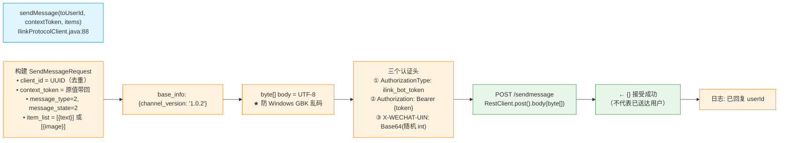

- `client_id` = UUID（每次不同，去重幂等性）
- `context_token` = 原值带回（关联原消息）
- `X-WECHAT-UIN` = 随机整数 → 无符号十进制 → Base64（防重放）
- 响应 `{}` 仅表示服务器接受，不代表已送达用户微信
- 所有 HTTP 响应使用 `byte[]` 读取再 UTF-8 解码，避免 GBK 乱码

**消息类型对照：**
| item type | 含义 | 用途 |
|-----------|------|------|
| 1 (TEXT) | 文本消息 | AI回复、天气、错误提示 |
| 2 (IMAGE) | 图片消息 | 图片识别、图片生成 |
| 3 (VOICE) | 语音消息 | Bot发送被静默丢弃 |
| 4 (FILE) | 文件消息 | TTS语音、文件发送 |

---

## 13. iLink 断开

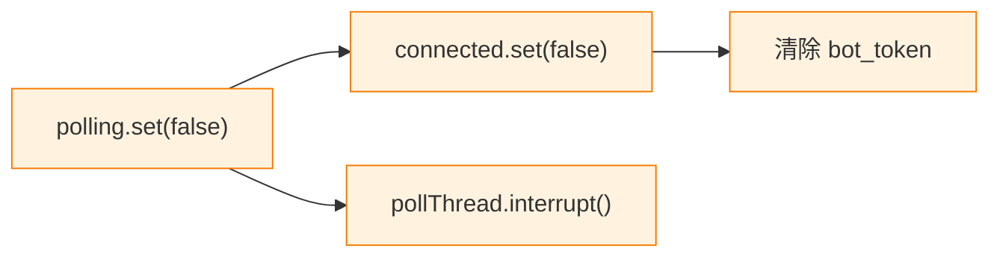

轮询条件不满足 → 线程自然退出。线程为 daemon 模式，程序退出时自动结束。
