# iLink 协议实现流程图

```mermaid
flowchart TB
    %% 样式定义
    classDef entry fill:#e1f5fe,stroke:#0288d1,stroke-width:2px
    classDef process fill:#fff3e0,stroke:#f57c00,stroke-width:1px
    classDef api fill:#e8f5e9,stroke:#388e3c,stroke-width:1px
    classDef decision fill:#fce4ec,stroke:#c62828,stroke-width:1px
    classDef external fill:#f3e5f5,stroke:#7b1fa2,stroke-width:1px
    classDef note fill:#fffde7,stroke:#f9a825,stroke-width:1px,stroke-dasharray:5 5

    %% ====== 一、程序入口 ======
    MAIN["程序入口 main()<br>YoukedaProjectApplication.java:14-50"]:::entry
    MAIN --> CONSOLE{"输入命令"}:::decision

    CONSOLE --> |"exit"| EXIT["退出程序<br>scanner.close() + context.close()"]:::process
    CONSOLE --> |"help / version / status"| CMD["CommandHandler.handle()<br>CommandHandler.java:17-39"]:::process
    CONSOLE --> |"weather &lt;城市&gt;"| WEATHER_CMD["WeatherService.queryWeather()<br>直接控制台查询"]:::process
    CONSOLE --> |"ilink login"| ILINK_START
    CONSOLE --> |"ilink status"| ILINK_STAT["IlinkService.isConnected()"]:::process
    CONSOLE --> |"ilink stop"| ILINK_STOP["IlinkService.stop()<br>IlinkService.java:144-154"]:::process

    %% stop 流程展开
    ILINK_STOP --> STOP_POLL["polling.set(false)"]:::process
    STOP_POLL --> STOP_INTERRUPT["pollThread.interrupt()"]:::process
    STOP_INTERRUPT --> STOP_CLEAR["清除 bot_token<br>connected.set(false)"]:::process
    STOP_CLEAR --> STOP_END["返回 'iLink 已断开'"]:::process

    %% ====== 二、iLink 登录流程 ======
    ILINK_START["IlinkService.start()<br>IlinkService.java:35-74"]:::entry

    subgraph LOGIN [iLink 登录流程]
        QR["① getQRCode()<br>GET /ilink/bot/get_bot_qrcode?bot_type=3<br>IlinkProtocolClient.java:52-58"]:::api
        QR_RESP["返回 JSON<br>{ qrcode: 'xxx', qrcode_img_content: 'url' }"]:::api
        PRINT["打印二维码 URL 到控制台<br>系统提示：请用微信扫码登录"]:::process

        QR --> QR_RESP --> PRINT

        POLL_LOOP2{"② 每 2 秒轮询状态"}:::decision
        POLL_API["pollQRStatus(qrcodeId)<br>GET /ilink/bot/get_qrcode_status?qrcode=xxx<br>IlinkProtocolClient.java:60-66"]:::api
        STATUS{"status?"}:::decision
        EXPIRED["返回 '二维码已过期'"]:::process
        WAITING["等待中..."]:::process
        CONFIRMED["③ 扫码确认成功"]:::process
        CRED["setCredentials(botToken, baseUrl)<br>IlinkProtocolClient.java:35-42<br>• 保存 bot_token<br>• 若 baseUrl 变化则重建 RestClient<br>• connected = true"]:::process

        PRINT --> POLL_LOOP2
        POLL_LOOP2 --> POLL_API --> STATUS
        STATUS --> |"waiting"| WAITING --> POLL_LOOP2
        STATUS --> |"expired"| EXPIRED
        STATUS --> |"confirmed"| CONFIRMED --> CRED
    end

    %% ====== 三、消息轮询 ======
    CRED --> POLL_THREAD

    subgraph POLLING [消息轮询循环]
        POLL_THREAD["④ startPolling() → 新线程<br>pollThread.setDaemon(true)<br>IlinkService.java:76-116"]:::entry
        POLL_THREAD --> UPDATES

        UPDATES["⑤ getUpdates(cursor)<br>POST /ilink/bot/getupdates<br>IlinkProtocolClient.java:68-72"]:::api
        UPDATES_NOTE["长轮询：服务器挂起连接最多 35 秒<br>有消息立即返回，无消息超时后空返回<br>每次返回新 cursor，下次请求带回"]:::note
        UPDATES --> UPDATES_NOTE

        UPDATES_RESP["返回 JSON<br>{ ret: 0, msgs: [...],<br>  get_updates_buf: 'new_cursor' }"]:::api
        HAS_MSG{"msgs != null &&<br>msgs 不为空?"}:::decision
        NO_MSG["更新 cursor<br>继续轮询"]:::process
        FOR_MSG["遍历 msgs<br>提取：fromUserId + text + contextToken"]:::process
        ERR_CHECK{"轮询抛异常?"}:::decision
        ERR_HANDLE["打印警告日志<br>sleep(6s) 后继续"]:::process
        POLL_CHECK{"polling.get() &&<br>connected.get()?"}:::decision
        POLL_END["轮询线程结束"]:::process

        UPDATES_NOTE --> UPDATES_RESP
        UPDATES_RESP --> HAS_MSG
        HAS_MSG --> |"否"| NO_MSG --> POLL_CHECK
        HAS_MSG --> |"是"| FOR_MSG
        UPDATES --> ERR_CHECK
        ERR_CHECK --> |"是"| ERR_HANDLE --> POLL_CHECK
        ERR_CHECK --> |"否"| UPDATES_RESP
        POLL_CHECK --> |"是"| UPDATES
        POLL_CHECK --> |"否"| POLL_END
    end

    %% ====== 四、消息路由 ======
    FOR_MSG --> HANDLE_MSG

    subgraph ROUTE [消息路由处理]
        HANDLE_MSG["⑥ handleMessage(msg)<br>IlinkService.java:118-142"]:::entry
        EXTRACT["extractText(msg)<br>从 item_list 中找到<br>type=1(text_item) 的文本<br>IlinkService.java:160-167"]:::process
        TEXT_NOTE["item_list支持多种类型<br>当前仅处理 type=1 文本消息<br>其他类型（图片/链接）忽略"]:::note
        ROUTE_DECIDE{"text.toLowerCase()<br>以什么开头?"}:::decision
        WEATHER_PATH["weather 或 天气<br>→ 天气查询"]:::external
        AI_PATH["其他<br>→ AI 对话"]:::external

        HANDLE_MSG --> EXTRACT --> TEXT_NOTE --> ROUTE_DECIDE
        ROUTE_DECIDE --> |"weather &lt;城市&gt;"| WEATHER_PATH
        ROUTE_DECIDE --> |"天气 &lt;城市&gt;"| WEATHER_PATH
        ROUTE_DECIDE --> |"其他"| AI_PATH
    end

    %% ====== 五、天气查询分支 ======
    subgraph WEATHER_BRANCH [天气查询]
        W_CITY["取城市名：<br>text.substring('weather/天气 '.length)"]:::process
        W_LOOKUP{"CITY_MAP 中查找<br>城市 → cityId"}:::decision
        W_MAP_NOTE["预置10个城市：北京/上海/广州/<br>深圳/杭州/成都/武汉/<br>南京/西安/重庆<br>WeatherService.java:24-47"]:::note
        W_API["请求和风天气 API<br>GET /v7/weather/now<br>?location=cityId&key=xxx<br>na3h2taynf.re.qweatherapi.com<br>WeatherService.java:72-88"]:::api
        W_PARSE["解析 JSON<br>提取：text / temp / feelsLike<br>humidity / windDir / windScale<br>WeatherService.java:90-119"]:::process
        W_FORMAT["格式化天气文本"]:::process
        W_INJECT["AIService.addExchange()<br>将天气问答注入 AI 对话历史<br>让 AI 知道刚刚问了天气<br>AIService.java:93-102"]:::process
        W_UNSUPPORT["返回：'暂不支持查询城市xxx'"]:::process
        W_REPLY_OK["reply = 天气文本"]:::process

        WEATHER_PATH --> W_CITY --> W_LOOKUP
        W_LOOKUP --> W_MAP_NOTE
        W_MAP_NOTE --> W_API --> W_PARSE --> W_FORMAT --> W_INJECT --> W_REPLY_OK
        W_LOOKUP --> |"找不到 cityId"| W_UNSUPPORT
    end

    %% ====== 六、AI 对话分支 ======
    subgraph AI_BRANCH [AI 对话]
        AI_GET["sessions.computeIfAbsent(userId)<br>获取/创建用户对话历史"]:::process
        AI_HISTORY_NOTE["session 结构：<br>[system消息, user/assistant...]<br>最多保留 10 轮<br>超出则删除最早（保留 system）<br>ConcurrentHashMap 线程安全"]:::note
        AI_ADD_USER["追加 user 消息到历史"]:::process
        AI_TRIM["trimHistory()<br>超出 MAX_HISTORY 则截断"]:::process
        AI_REQ["构建 ChatRequest<br>{ model:'deepseek-chat', messages:[...] }"]:::process
        AI_API["POST /chat/completions<br>Authorization: Bearer xxx<br>body = byte[] (UTF-8)<br>AIService.java:51-64"]:::api
        AI_RESP["解析 ChatResponse<br>提取 choices[0].message.content"]:::process
        AI_ADD_ASST["追加 assistant 回复到历史"]:::process
        AI_REPLY_OK["reply = AI 回复文本"]:::process
        AI_ERROR["返回 'AI 服务异常: ...'"]:::process

        AI_PATH --> AI_GET --> AI_HISTORY_NOTE
        AI_HISTORY_NOTE --> AI_ADD_USER --> AI_TRIM --> AI_REQ --> AI_API
        AI_API --> AI_RESP --> AI_ADD_ASST --> AI_REPLY_OK
        AI_API --> AI_ERROR
    end

    %% ====== 七、发送回复 ======
    W_REPLY_OK --> SEND_REPLY
    W_UNSUPPORT --> SEND_REPLY
    AI_REPLY_OK --> SEND_REPLY
    AI_ERROR --> SEND_REPLY

    subgraph SEND [发送回复]
        SEND_REPLY["⑦ sendMessage(toUserId, contextToken, reply)<br>IlinkProtocolClient.java:74-85"]:::entry

        BUILD_REQ["构建 SendMessageRequest<br>IlinkProtocolClient.java:75-77"]:::process
        REQ_DETAIL["序列化后 JSON 结构：<br>{<br>  msg: {<br>    from_user_id: '',<br>    to_user_id: 'wxid_xxx',<br>    client_id: 'uuid' (每次唯一),<br>    message_type: 2,<br>    message_state: 2,<br>    context_token: '原值带回',<br>    item_list: [{<br>      type: 1,<br>      text_item: { text: '回复内容' }<br>    }]<br>  }<br>}"]:::note

        AUTH_HEADERS["添加三个认证头：<br>① AuthorizationType: ilink_bot_token<br>② Authorization: Bearer bot_token<br>③ X-WECHAT-UIN: Base64(随机无符号整数)<br>IlinkProtocolClient.java:87-108"]:::process
        AUTH_UIN["X-WECHAT-UIN 生成逻辑：<br>ThreadLocalRandom.nextInt()<br>→ Integer.toUnsignedString()<br>→ Base64.encode()<br>每次请求不同，防重放"]:::note

        ENCODE["body = byte[] (UTF-8)<br>response = byte[] → UTF-8 String<br>解决 Windows GBK 乱码"]:::process
        SEND_API["POST /ilink/bot/sendmessage<br>IlinkProtocolClient.java:92-102"]:::api
        SEND_RESP["返回 {} 即接受成功<br>（仅表示服务器已接收<br>不保证消息已送达用户）"]:::api

        SEND_REPLY --> BUILD_REQ --> REQ_DETAIL
        REQ_DETAIL --> AUTH_HEADERS --> AUTH_UIN
        AUTH_UIN --> ENCODE --> SEND_API --> SEND_RESP
    end

    %% 发完回复回到轮询
    SEND_RESP --> POLL_CHECK
```



## 关键问答（演示用）

**Q1：为什么消息能实时收到？用的 WebSocket 吗？**
A：不是 WebSocket，是**长轮询（Long Polling）**。每次请求 `/getupdates` 时，服务器如果没有新消息会挂起连接最多 35 秒，有消息立即返回。返回后立刻发起下一次请求，形成持续连接效果。

**Q2：怎么保证不重复处理同一条消息？**
A：每次 `/getupdates` 返回一个 `get_updates_buf`（游标/cursor），下次请求时带回。服务器根据游标只返回**未消费的消息**，消费过的不会再返回。

**Q3：用户发消息后多久能收到回复？**
A：最长等待 = 轮询间隔（3 秒）+ API 处理时间。天气查询约 0.5 秒，DeepSeek AI 约 1-3 秒。总延迟通常 **4-6 秒**。

**Q4：X-WECHAT-UIN 是什么？为什么每次都不一样？**
A：微信用来防重放攻击的机制。每次请求生成一个随机无符号整数 → 转十进制字符串 → Base64 编码。同一个 token 但 UIN 不同，服务器认为是不同请求。

**Q5：为什么用 byte[] 而不是 String？**
A：Windows 控制台默认 GBK 编码。RestClient 的 `body(String.class)` 会按系统编码解码，导致中文乱码。用 `byte[]` 拿到原始字节，再用 `new String(bytes, StandardCharsets.UTF_8)` 确保编码正确。

**Q6：多人同时发消息会冲突吗？**
A：不会。`getUpdates` 返回所有未消费消息列表，逐条处理。每个用户有独立的 AI session（`ConcurrentHashMap<String, List<ChatMessage>>`），互不干扰。

**Q7：context_token 有什么用？**
A：用于关联同一会话的消息。收到消息时携带 context_token，发送回复时原值带回，微信据此知道这条回复是对应哪条消息的。

**Q8：程序退出后聊天记录还在吗？**
A：不在。当前 AI 对话历史存在内存 `ConcurrentHashMap` 中，重启后清空。如需要持久化，可考虑 H2 数据库。

## 文件结构

```
src/main/java/com/example/youkeda_project/
├── YoukedaProjectApplication.java   入口 + 控制台循环
├── config/
│   └── ApiConfig.java               读取 application.properties 配置
├── command/
│   └── CommandHandler.java          命令分发（help/version/status/ilink）
├── client/
│   └── IlinkProtocolClient.java     核心：iLink HTTP 客户端
├── protocol/                        7 个 iLink 协议 DTO
│   ├── QRCodeResponse.java          二维码响应
│   ├── LoginResult.java             登录结果
│   ├── GetUpdatesResponse.java      消息拉取响应
│   ├── WeixinMessage.java           单条消息
│   ├── MessageItem.java             消息条目
│   ├── TextItem.java                文本内容
│   └── SendMessageRequest.java      发送消息请求
├── service/
│   ├── IlinkService.java            iLink 登录/轮询/回复编排
│   └── WeatherService.java          和风天气查询
└── ai/
    ├── AIService.java               DeepSeek AI 对话
    ├── ChatRequest.java              AI 请求 DTO
    ├── ChatResponse.java             AI 响应 DTO
    ├── ChatMessage.java              消息体 DTO
    └── ChatChoice.java               选择结果 DTO
```
