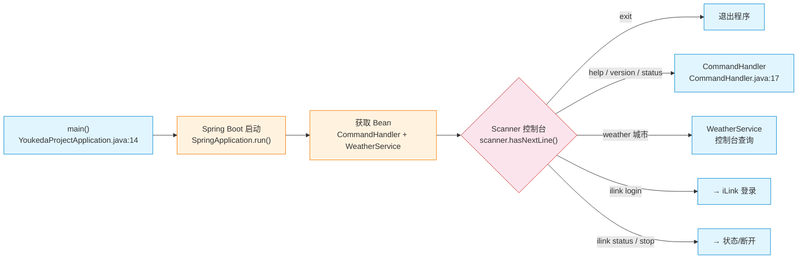
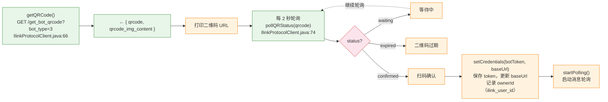
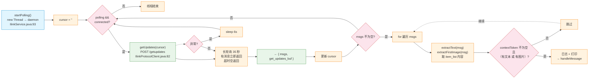
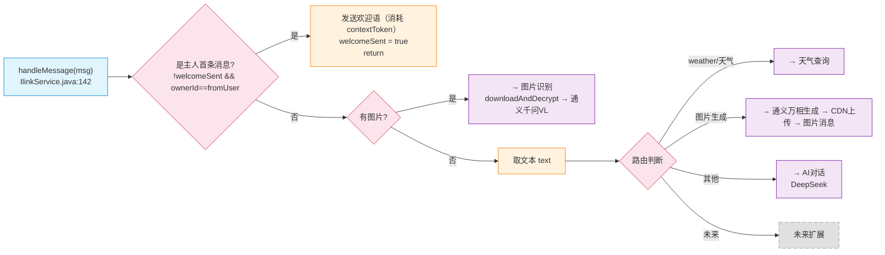
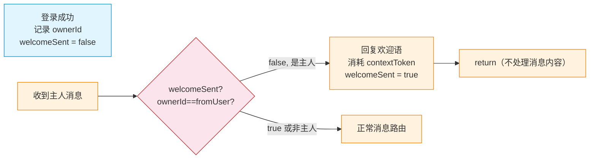
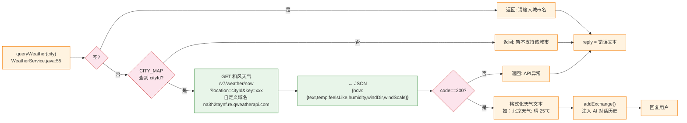
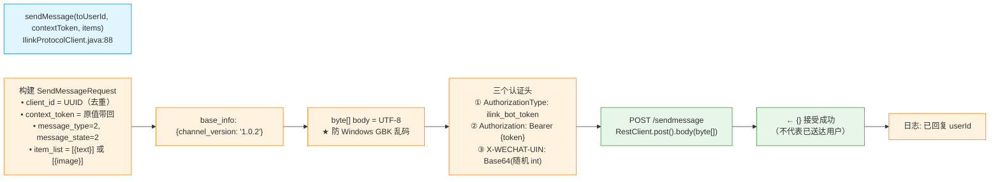
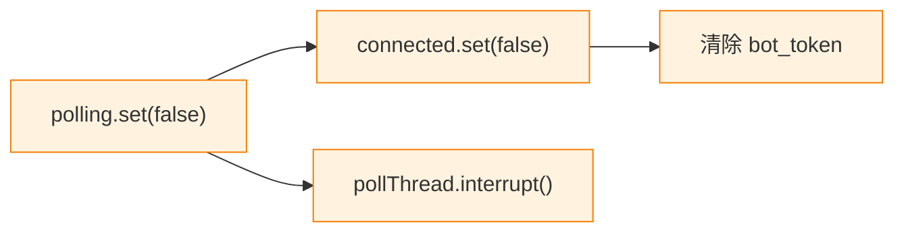

# Claw助手 流程图

WeChat Bot · iLink 协议 · 和风天气 · DeepSeek AI · 通义万相 · 通义千问 VL

---

## 0. 程序入口 — 控制台循环

Spring Boot 启动后进入 `main()`，使用 `Scanner` 监听控制台输入。
支持命令：`help` / `version` / `status` / `weather <城市>` / `ilink login/status/stop` / `exit`。

---

## 1. iLink 登录流程

请求微信 iLink 服务器获取二维码 → 返回 `qrcode_id` 和二维码 URL → 打印到控制台 → 每 2 秒轮询状态 → 用户扫码确认后返回 `bot_token`（身份凭证）和 `baseUrl`。登录成功后记录 `ownerId`（`ilink_user_id`），用于后续欢迎消息触发。

★ `LoginResult` 包含 `ilink_user_id`（主人微信ID）、`ilink_bot_id`（机器人ID）、`bot_token`、`baseUrl`。

---

## 2. 消息轮询（独立线程）

长轮询：服务器挂起最多 35 秒，有消息立即返回。每次返回 `get_updates_buf`（游标），下次请求时带回，确保不重复消费。过滤条件：必须有 `contextToken`，且至少包含文本或图片（单纯语音消息跳过）。

---

## 3. 消息路由 — handleMessage

路由流程：
1. **首条消息检测**：若为登录记录的主人首次发消息，仅回复欢迎语（消耗该消息），不处理内容
2. **图片消息**：CDN 下载 → AES 解密 → 通义千问 VL 识别
3. **文本消息**：
   - `weather` / `天气` 开头 → 和风天气查询
   - `图片生成` 开头 → 通义万相生图 → CDN 上传 → 图片消息
   - 其他 → DeepSeek AI 对话

路由分支用 `startsWith` 判断，未来可在此处扩展更多命令。

---

## 4. 首条消息欢迎机制

因 iLink 协议不支持 Bot 主动推送消息，欢迎语通过「消耗主人第一条消息」的方式发送。
首次连接后，主人发的第一条消息会被用于回复欢迎语（消息内容被消耗不处理）。

---

## 5. 天气查询（和风天气）

预置 10 城市 ID 映射表（北京/上海/广州/深圳/杭州/成都/武汉/南京/西安/重庆）。通过自定义域名 `na3h2taynf.re.qweatherapi.com` 请求和风天气 API，解析 JSON 后格式化为可读文本。结果注入 AI 对话历史，便于后续上下文追问。

---

## 6. AI 对话（DeepSeek）

```mermaid
flowchart LR
    AS["sessions.computeIfAbsent(userId)<br>ConcurrentHashMap<br>AIService.java:48"]:::process
    AE{"首次对话?"}:::decision
    AS --> AE
    AE --> |"是"| AN["创建 session<br>添加 system 消息"]:::process
    AE --> |"否"| AO["使用现有历史"]:::process
    AN --> AA
    AO --> AA
    AA["追加 user 消息到历史"]:::process
    AT["trimHistory()<br>保留最近 10 轮"]:::process
    AR["POST /chat/completions<br>model: deepseek-chat<br>api.deepseek.com<br>byte[] 编码防乱码"]:::api
    AX["← choices[0].message.content"]:::api
    AA --> AT --> AR --> AX
    AX --> AC{"有内容?"}:::decision
    AC --> |"否"| AER["返回: 无内容"]:::process
    AC --> |"是"| AAS["追加 assistant 回复到历史"]:::process
    AAS --> AOK["reply = AI 回复 → 回复用户"]:::process

    classDef process fill:#fff3e0,stroke:#f57c00;
    classDef decision fill:#fce4ec,stroke:#c62828;
    classDef api fill:#e8f5e9,stroke:#388e3c;
```

每个微信用户独立对话 session（`ConcurrentHashMap<String, List<ChatMessage>>`），结构：`[system, user, assistant, user, ...]`。最多保留 10 轮对话，超出截断。使用 `byte[]` 编解码防止 Windows 控制台乱码。

---

## 7. 图片识别（通义千问 VL）

1. **CDN 下载**：从 `image_item.media.full_url` 或拼接 CDN URL 下载 AES 加密的图片字节
2. **AES 解密**：`deriveAesKey()` 兼容 3 种 key 格式（32字符 hex / base64(hex) / base64(raw 16字节)），AES-128-ECB 解密后去除 PKCS7 padding
3. **视觉识别**：图片 Base64 → `data:` URI → 通义千问 VL（`qwen-vl-plus`），复用 DashScope key

---

## 8. 图片生成（通义万相）→ CDN 上传 → 发送

1. **生图**：通义万相 `wan2.6-t2i`（同步模式 POST），返回 OSS 图片 URL
2. **加密**：随机 16 字节 AES key → AES-128-ECB 加密图片字节（PKCS5Padding）
3. **CDN 上传**：请求上传 URL → POST 加密字节 → 获取 `x-encrypted-param`
4. **发送**：构建 `image_item.cdnImage(CDNMedia, midSize)` → `sendMessage`

★ `getUploadUrl` 请求包含：`filekey`（32 hex）、`media_type:1`、`to_user_id`、`rawsize`、`rawfilemd5`、`filesize`（填充后）、`aeskey`（hex）、`no_need_thumb:true`。

---

## 9. 发送回复到微信

- `client_id` = UUID（每次不同，去重幂等性）
- `context_token` = 原值带回（关联原消息）
- `X-WECHAT-UIN` = 随机整数 → 无符号十进制 → Base64（防重放）
- 响应 `{}` 仅表示服务器接受，不代表已送达用户微信
- 所有 HTTP 响应使用 `byte[]` 读取再 UTF-8 解码，避免 GBK 乱码

---

## 10. iLink 断开

轮询条件不满足 → 线程自然退出。线程为 daemon 模式，程序退出时自动结束。
