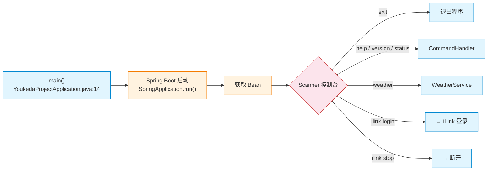
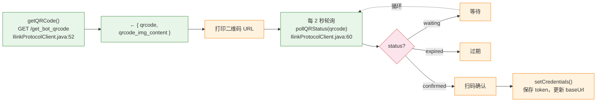
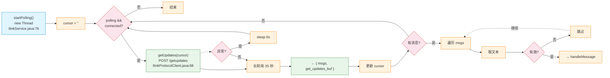
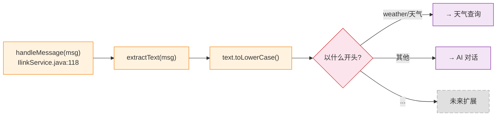
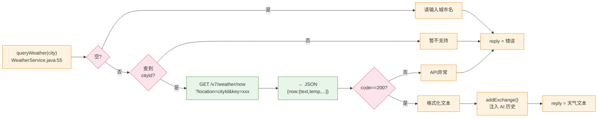
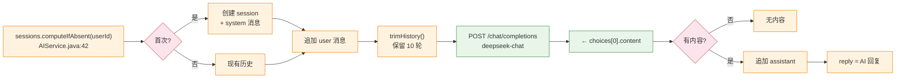
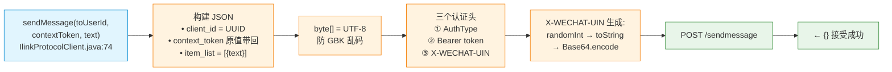
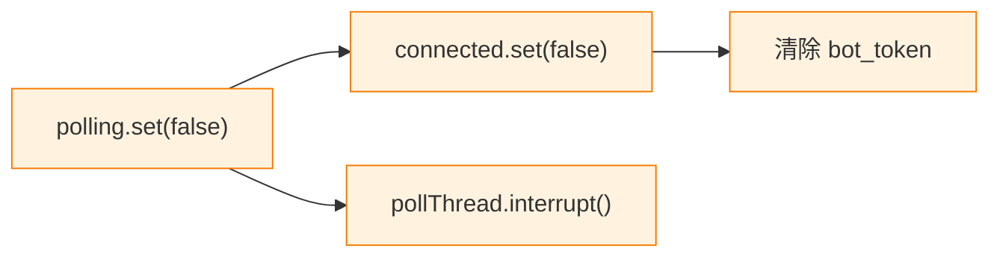

# Claw助手 流程图

WeChat Bot · iLink 协议 · 和风天气 · DeepSeek AI

---

## 0. 程序入口 — 控制台循环

Spring Boot 启动后进入 `main()`，使用 `Scanner` 监听控制台输入。
支持命令：`help` / `version` / `status` / `weather <城市>` / `ilink login/status/stop` / `exit`。

---

## 1. iLink 登录流程

请求 iLink 服务器获取二维码 → 返回 `qrcode_id` 和二维码 URL → 打印到控制台 → 每 2 秒轮询状态 → 用户扫码确认后返回 `bot_token`（身份凭证）和 `baseUrl`。

★ `bot_token` 是后续所有请求的密码。`baseUrl` 可能从 `ilinkai` 变为 `ilinkii`（负载均衡），需动态重建 RestClient。

---

## 2. 消息轮询（独立线程）

长轮询：服务器挂起最多 35 秒，有消息立即返回。每次返回 `get_updates_buf`（游标），下次请求时带回，确保不重复消费。

---

## 3. 消息路由

从 `item_list` 提取文本 → 判断开头：`weather`/`天气` 走天气查询，其他走 AI。

---

## 4. 天气查询（和风天气）

预置 10 城市 ID → 查和风天气 API → 解析 JSON → 格式化文本。结果注入 AI 历史，使后续"明天呢"等上下文问题得以理解。

---

## 5. DeepSeek AI 对话

每用户独立 session（`ConcurrentHashMap`），最多 10 轮历史，超出截断。请求 DeepSeek API 并用 byte[] 防乱码。

---

## 6. 发送回复到微信

- `client_id` = UUID（去重）
- `context_token` = 原值带回（关联原消息）
- `X-WECHAT-UIN` = 随机数 Base64（防重放）
- 响应 `{}` 表示已接受，不代表已送达

---

## 7. iLink 断开

轮询条件不满足 → 线程自然退出。线程为 daemon 模式，程序退出时自动结束。
